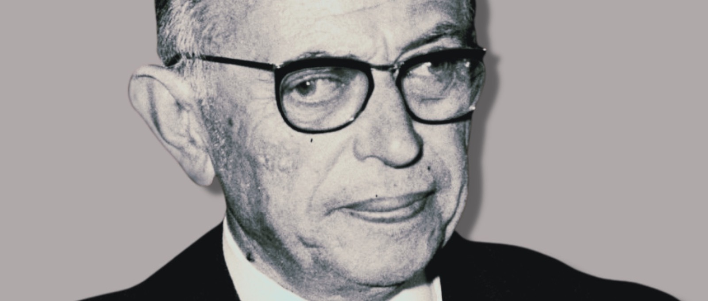

## 詹姆斯：被看见是人类最深刻的渴望
1890年，威廉·詹姆斯在《心理学原理》中提出过一个思想实验：如果一个人走进房间，没有人抬头；他开口说话，没有人回应；他采取任何行动，都没有人在意；遇到的每个人都像对待一件不存在的死物一样对待他——那么，这可能是比肉体折磨更残酷的刑罚。

詹姆斯说，在这种彻底的“不被看见”中，人很快会涌起狂怒与无力的绝望。

这个设想之所以令人不安，是因为它触及了一个很深的命题：人对“被看见”的渴望，并不只是虚荣。在漫长的演化史中，被群体看见通常意味着安全；被无视、被流放、被当作不存在，则意味着危险。婴儿更是如此。一个孩子最早正是通过大人的眼神、语气和表情，逐渐知道自己是谁、自己的感受是否有意义。被看见，不只是“有人夸我”，而是“我在这里，我的存在有人回应”。

*孤独的树*

## 萨特：他者的目光，是一场微型政变

萨特在《存在与虚无》中对“注视”的分析，是理解“被看见”最锋利的一把刀。

他先区分了两种存在方式。一种是“**自在存在**”，石头、桌子、椅子属于这种存在。它们是什么就是什么，固定、充实，没有意识，也没有自由。一块石头不会在夜里思考明天是否换一种活法；它没有可能性，只有既定事实。另一种是“**自为存在**”，即人的意识。萨特说，意识的核心是“虚无”。这并非说人虚无缥缈，而是说人没有预先固定的本质。人不是先有一个完成好的“自我”，然后才去生活；人是在不断选择、行动和超越自身的过程中，才成为自己。人永远不是已经完成之物，而始终向未来敞开。

这是人的自由，也是人的尊严：我不是一件现成的物品，而是一组尚未兑现的可能性。

然后，萨特举了那个著名的例子。一个人趴在门缝前偷看房间里的景象。这一刻，他完全沉浸在偷看这一行动中。他没有审视自己，他就是他的行动本身。他处在“自为存在”的状态里：流动、自由、非反思。

突然，走廊里传来脚步声。他意识到：有人在看我。

就在这一瞬间，他者的目光像一道强光，把我原本流动的自由意识瞬间冻结。我原本是“自为存在”——一个不断超越自身、拥有无数可能性的主体；但在那个人的目光下，我猛然坠入“为他存在”——我变成了他世界中的一个对象、一个固定物、一个“偷看的人”。我像墙角的一件家具，被钉在了那个位置上。

萨特写得很重：我突然意识到，我自己正在逃离我自己。我的根基不再在我这里，而是悬在别人那里。我是什么，不再由我的自由决定，而由那个看我的人决定。

伴随这种坠落而来的情绪，就是羞耻。

萨特所说的羞耻，与日常理解并不完全相同。我们通常以为羞耻是“我做错了某件事”，但萨特所说的羞耻更根本：它不是道德反省，而是存在论层面的不安。羞耻的本质在于——我不得不承认，我确实就是他者正在注视和评判的那个对象，而这个对象的性质完全掌握在别人手里，脱离了我的自由控制。

*萨特*

一个常见的场景可以说明这一点。一个人独自在房间里跳舞，跳得很投入，很自在。那一刻，他是“自为存在”，他就是他的舞蹈，他没有表演给谁看。突然，门开了，有人站在门口看着他。

那一瞬间，他整个人会僵住。不是因为他做错了什么，而是因为他从“跳舞的人”变成了“被看见在跳舞的人”。动作还在，但它已经被固定了：在对方眼里，他成了一个“正在跳舞的人”，一个可以被描述、被评价、被记住的对象。原本流动的快乐被打断了，他开始想：对方看到了多少？对方觉得我奇怪吗？我该如何反应？

这就是萨特所说的客体化。他者的目光把我从自由主体降格为固定客体。

而且，萨特认为，这不是偶然的、可以轻易摆脱的意外。这是主体间关系的根本结构。只要他者存在，我就永远可能被他者的目光捕获。我永远无法完全控制别人怎么看我，因为我的“为他存在”本质上不在我手里。

这也解释了为什么有些目光让人舒展，有些目光让人僵硬。并非所有注视都一样。关键在于：那个目光是把我看成一个活生生的人，还是把我钉成一个标签、一个功能、一个刻板印象。

## 萨特的死结：为什么我们既渴望又恐惧

萨特的分析之所以深刻，是因为它揭示了一个死结。

一方面，人无法独自确认自己。我们需要他者的目光来知道自己是谁。一个完全不被看见的人，会像詹姆斯所说的那样陷入狂怒和绝望。

另一方面，他者的目光又必然把我客体化。只要有人看我，我就可能被固定、被评判、被降格为物。

所以萨特说：他人即地狱。

在他者的目光下，我永远无法完全做回那个自由的主体。我永远被囚禁在别人对我的定义里。我要么试图把别人也客体化，以此夺回主体地位；要么试图让自己成为别人眼中的完美对象，以此换取承认。但这两条路都走不通。前者是暴君，后者是奴隶，都不是自由人之间的相遇。

## 对话性确证与存在之爱

布伯区分了“我-它”和“我-你”。“**我-它**”是把对方当作对象来分析、利用、评价。萨特所描述的注视，本质上就是“我-它”的目光：我看你，是为了把你固定成某个东西。而在“**我-你**”的关系里，我不是在审视你，而是在与你相遇。我放下预设和功利计算，用完整的自己去面对另一个不可化约的人。此时，目光不再是冻结，而是确证。

马斯洛从心理学角度讲了类似的事。**匮乏之爱**是因为我需要你，所以我才爱你；**存在之爱**则是看见对方本身，把对方当作目的，而不是工具。前者常常伴随焦虑和控制，因为人害怕失去这个“供给源”；后者更接近一种清明的看见：我不用从你身上榨取什么，也能欣赏你本来的样子。

列维纳斯则把问题推到伦理学的高度。他说，他者的“面容”不是五官长相，而是他人身上那个不能被我们完全占有、理解和归类的部分。真正的面容是脆弱的、不设防的，它在前语言层面召唤我们：“不要置我于不顾。”在被他者看见并召唤的那一刻，自我从自恋中惊醒，发现自己早已处在对他者的责任之中。

因此，人类恐惧的从来不是“被看见”本身，而是萨特所描述的那种把人物化的注视。人类真正渴望的，是在“我-你”相遇中不带占有欲的确证。

*《终将成为你》*

## 所以……

詹姆斯的思想实验告诉我们，完全不被看见是一种刑罚。

萨特提醒我们，被错误地看见，同样会让人窒息。他者的目光可以是一场微型政变，把我从自由主体降格为固定客体，让我在自己之外悬空。

布伯、马斯洛和列维纳斯指向同一个方向：人真正渴望的，不是在任何目光下被曝光，而是在另一个独立、自由、不占有的人那里，被承认、被确证、被当作一个完整的人来对待。

